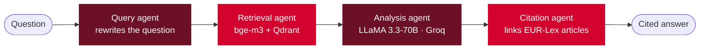

<p align="center">
  
</p>

<p align="center">
  <a href="https://ikram-saidane.github.io"></a>
</p>

<p align="center">
  <a href="https://ikram-saidane.github.io"></a>
  <a href="https://linkedin.com/in/ikram-saidane"></a>
  <a href="mailto:ikram.saidane@dauphine.eu"></a>
  <br>
  
  
  
</p>

---

### 🍒 About me

```python
class IkramSaidane:
    studies   = "M2 AI, Data Science & Agentic AI · Université Paris Dauphine – PSL (Master IASD)"
    focus     = ["GenAI", "RAG", "Multi-agent systems", "Machine Learning", "MLOps"]
    building  = "Agora · multi-agent assistant for EU regulation"
    previously = "GenAI / RAG intern @ Capgemini Engineering (18/20)"
    languages = ["Arabic", "French", "English", "German (beginner)"]
    looking_for = "6-month end-of-studies internship (PFE) · from February 2027 · France"
```

---

### ⭐ Featured · [Agora](https://github.com/Ikram-Saidane/Agora)

**Multi-agent regulatory watch on the EUR-Lex corpus** (AI Act, GDPR, DSA, DMA).
Four LangGraph agents pass the question along, and every answer cites the exact articles it relies on.



<p>
  
  
  
  
  
</p>

---

### 🧪 Projects

<details open>
<summary><b>GenAI & Agentic AI</b></summary>
<br>

| Project | What it does | Result | Stack |
|---|---|---|---|
| **[Agora](https://github.com/Ikram-Saidane/Agora)** | Multi-agent RAG over EU regulation | Context recall **0.93** | LangGraph · Qdrant · LLaMA 3.3 · RAGAS |
| **RAG pipeline · Capgemini** | Document Q&A, fully local (no cloud API) | Context precision **0.85** | LangChain · ChromaDB · LLaMA 3.1 · Ollama |
| **PRIMIA** · EY × Dauphine hackathon | An LLM reads financial PDF reports, a model scores risk on 7 indicators | SaaS prototype | Gemini · Random Forest · XGBoost |

</details>

<details open>
<summary><b>Machine Learning & MLOps</b></summary>
<br>

| Project | What it does | Result | Stack |
|---|---|---|---|
| **[Churn Prediction API](https://github.com/Ikram-Saidane/churn-prediction-api)** | End-to-end MLOps on IBM Telco (7,043 customers) | AUC **0.840** | FastAPI · Docker · GitHub Actions · Railway |
| **[House Prices](https://github.com/Ikram-Saidane/house-prices-kaggle)** | Kaggle Ames Housing, stacking ensemble | **58th / 5,235** · RMSLE 0.11464 | XGBoost · LightGBM · CatBoost |
| **[Tunisia Tourism Forecasting](https://github.com/Ikram-Saidane/tunisia-tourism-forecasting)** | Monthly tourism flows, 24 governorates (2017–2025) | Forecasts + maps | Random Forest · MLP · LSTM · GeoPandas |
| **Hotel cancellations** | Booking cancellation prediction with explainability | AUC **0.915** | SMOTE · SHAP · LIME |
| **[Bayesian Network](https://github.com/Ikram-Saidane/R-seau-Bay-sien)** | Course project in probabilistic modelling | | Bayesian networks |

</details>

---

### 🛠️ Tech stack

<p>
  <b>GenAI & Agentic AI</b><br>
  
  
  
  
  
  
  
  
</p>
<p>
  <b>Machine Learning</b><br>
  
  
  
  
  
  
</p>
<p>
  <b>MLOps & tools</b><br>
  
  
  
</p>

---

### 📊 GitHub in real time

<p align="center">
  
  
</p>
<p align="center">
  
</p>
<p align="center">
  
</p>

<p align="center">
  <picture>
    <source media="(prefers-color-scheme: dark)" srcset="https://raw.githubusercontent.com/Ikram-Saidane/Ikram-Saidane/output/github-snake-dark.svg">
    
  </picture>
</p>

---

### ⚡ Recent activity

<!--START_SECTION:activity-->
<!--END_SECTION:activity-->

---

### 🎓 Journey

| When | What |
|---|---|
| 2025 → now | **M2 AI, Data Science & Agentic AI** · Université Paris Dauphine – PSL |
| 2025 → now | **IT & training lead** · DataIn club · co-organiser of the EY × Dauphine hackathon |
| Dec 2025 | **PRIMIA** · AI / InsurTech hackathon (Dauphine & EY) |
| Jan – May 2025 | **GenAI / RAG intern** · Capgemini Engineering · grade 18/20 |
| 2023 – 2024 | **Web development intern** · Dreamtek Consulting |
| 2021 – 2025 | **BSc Computer Science, Software Engineering** · ISTIC |

---

<p align="center">
  <b>Hiring a GenAI / ML intern from February 2027?</b><br>
  Let's talk: <a href="mailto:ikram.saidane@dauphine.eu">ikram.saidane@dauphine.eu</a> · <a href="https://ikram-saidane.github.io">ikram-saidane.github.io</a>
  <br><br>
  
</p>
